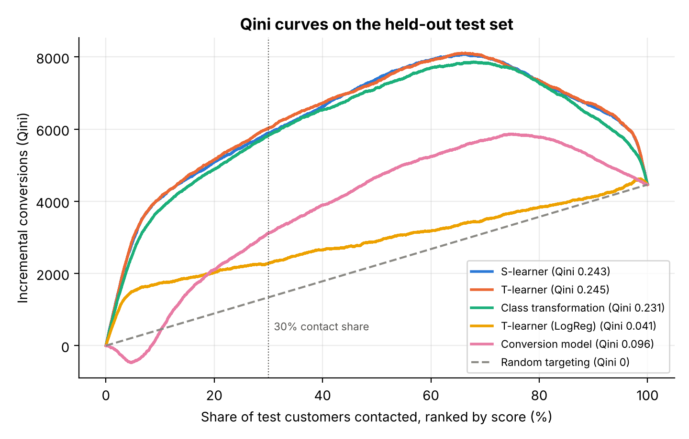
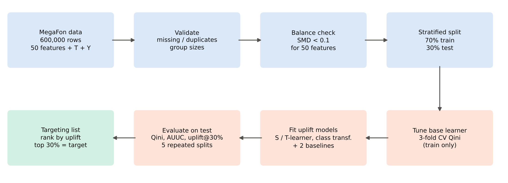
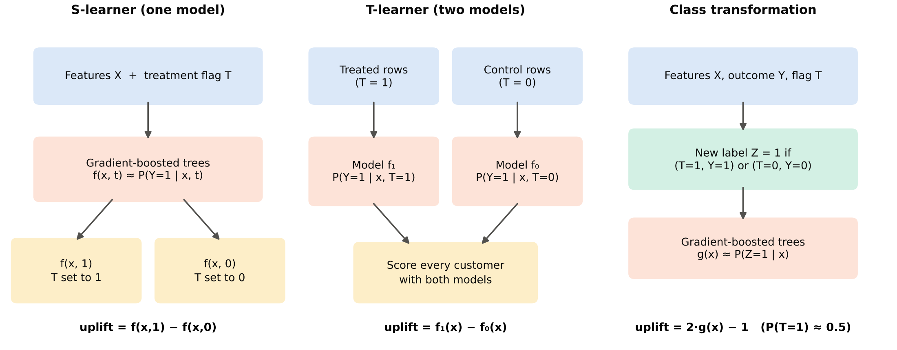
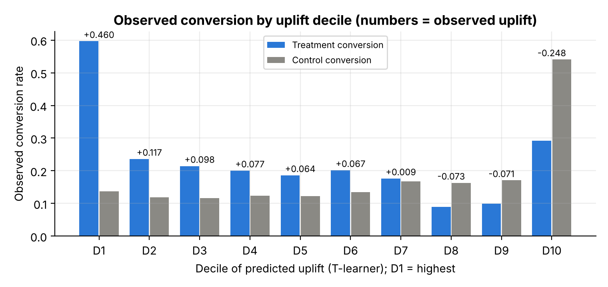
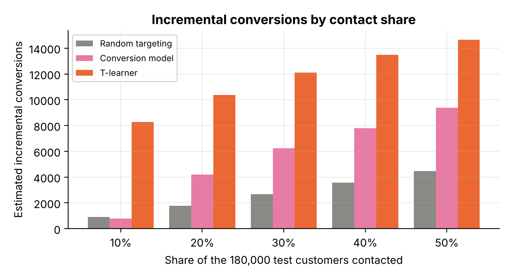
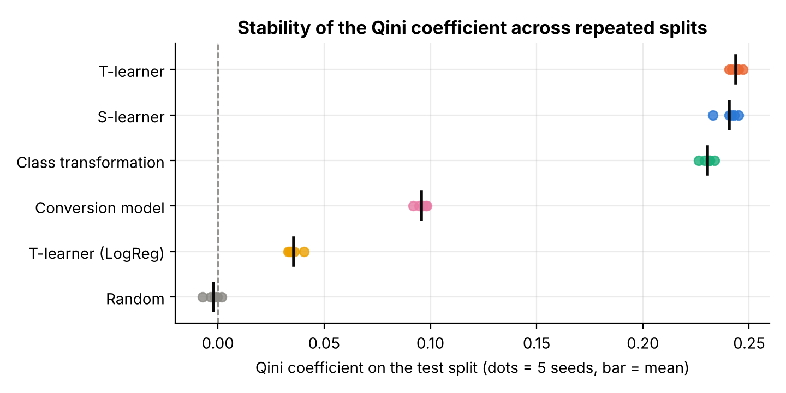
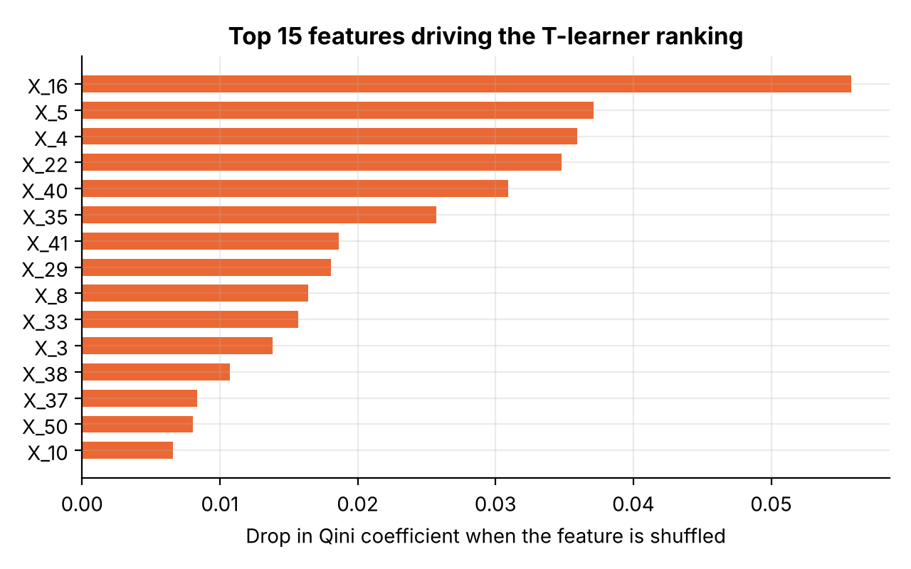

# Uplift Modeling for Personalized Marketing in Telecommunications

[](https://github.com/YOUR_USERNAME/uplift-modeling-telecom/actions/workflows/ci.yml)
[](https://colab.research.google.com/github/YOUR_USERNAME/uplift-modeling-telecom/blob/main/notebooks/uplift_modeling_megafon.ipynb)


[](LICENSE)

**Which telecom subscribers should receive a marketing offer so that the campaign creates the most
*additional* conversions?** This project answers that with uplift modeling on the 600,000-customer
MegaFon randomized campaign, and shows that ranking customers by predicted uplift beats both random
targeting and the usual "most likely to buy" conversion model.

> Final project for the course **Applied Machine Learning**, Astana IT University, 2026.
>
> **Students:** Abilkhay Askar, Kolzhabay Olzhas  ·  **Group:** Big Data Analysis 2406

<p align="center">
  
</p>

## Key results

Held-out test set of 180,000 customers; Qini and AUUC are normalized (random = 0, perfect = 1).

| Model | Qini | AUUC | Uplift@30% | Mean Qini, 5 splits (SD) |
|---|---:|---:|---:|---:|
| **T-learner** (final model) | **0.245** | **0.170** | **22.4%** | **0.244 (0.0026)** |
| S-learner | 0.243 | 0.168 | 21.9% | 0.241 (0.0046) |
| Class transformation | 0.231 | 0.160 | 21.7% | 0.230 (0.0027) |
| Conversion model (baseline) | 0.096 | 0.067 | 11.5% | 0.096 (0.0026) |
| Linear T-learner | 0.041 | 0.028 | 8.5% | 0.036 (0.0030) |
| Random targeting (baseline) | −0.003 | −0.002 | 4.5% | −0.002 (0.0034) |

- **2.5× better ranking than the conversion model** (Qini 0.245 vs 0.096), stable on all 5 splits.
- **4.5× more incremental conversions than random targeting** at a 30% budget
  (about 12,100 vs 2,700 among 54,000 contacted customers).
- **35% of customers have negative predicted uplift.** In that group the offer lowers conversion by
  11.5 percentage points, so they should not be contacted.
- All **9 success criteria** from the project proposal are met.

## Problem

A typical campaign contacts the customers with the highest predicted probability to buy. Many of them
would buy anyway, and some react badly to being contacted. Uplift modeling estimates the change caused by
the offer for each customer:

$$\text{uplift}(x) = P(Y=1 \mid x, T=1) - P(Y=1 \mid x, T=0)$$

This is possible because the MegaFon campaign was randomized: one group got the offer ($T=1$), the other
did not ($T=0$).

## Data

[MegaFon Uplift Competition](https://ods.ai/tracks/df21-megafon/competitions/megafon-df21-comp/data)
(ODS.ai, 2021): 600,000 customers, 50 anonymized numeric features, a treatment flag and a binary
conversion outcome. The data are synthetic but imitate a real telecom campaign.

| | Control | Treatment |
|---|---:|---:|
| Customers | 299,632 | 300,368 |
| Conversion rate | 17.9% | 22.9% |

The offer raises conversion by **4.95 percentage points** on average (95% CI 4.75 to 5.16). No missing
values or duplicates; the largest standardized mean difference between groups is 0.0046, far below the
0.1 threshold, so assignment is random. The dataset is not stored in the repository; see
[`data/README.md`](data/README.md).

## Method

<p align="center">
  
</p>

1. Validate the data and check group balance (SMD for all 50 features).
2. Stratified 70/30 split on treatment × conversion; the test set is used only at the end.
3. Three uplift approaches on histogram gradient-boosted trees: **S-learner**, **T-learner** and
   **class transformation**, plus a linear T-learner and two baselines (random scores and a conversion
   classifier).
4. Tune the base learner by **3-fold cross-validated Qini on the training set** (not by accuracy).
5. Evaluate with Qini, AUUC and uplift@30% on the test set and on 5 repeated splits; pick the approach
   with the highest mean Qini.
6. Rank customers by predicted uplift and send the offer to the top 30%.

<p align="center">
  
</p>

Formulas, the tuning grid and metric definitions are in [`docs/methodology.md`](docs/methodology.md).

## Results in figures

| Observed uplift by decile | Incremental conversions by budget |
|---|---|
|  |  |
| In the top decile the offer lifts conversion from 13.7% to 59.7%; in the bottom decile it drops from 54.1% to 29.3%. | Estimated extra conversions for contact shares of 10–50%. |

| Stability over 5 splits | Feature influence (permutation, Qini drop) |
|---|---|
|  |  |

All figures are in [`figures/`](figures) and all tables in [`results/`](results).

## Repository structure

```text
uplift-modeling-telecom/
├── notebooks/
│   └── uplift_modeling_megafon.ipynb   # complete executed analysis (Colab-ready)
├── src/uplift_telecom/                 # the same pipeline as a reusable package
│   ├── config.py                       # seeds, grid, paths
│   ├── data.py                         # download, load, validate, balance, split
│   ├── models.py                       # S-/T-learner, class transformation, baselines
│   ├── evaluation.py                   # CV tuning, Qini/AUUC, repeated splits, deciles, importance
│   ├── targeting.py                    # ranked targeting list
│   ├── plots.py                        # figures
│   └── pipeline.py                     # end-to-end CLI
├── scripts/                            # download_data.py, run_pipeline.py, make_diagrams.py
├── tests/                              # unit + end-to-end tests on synthetic data
├── figures/                            # fig1–fig7 and diagrams/
├── results/                            # metrics, CV table, deciles, targeting list, summary.json
├── reports/                            # paper, presentation, executed notebook, submission PDF
├── docs/methodology.md
├── data/                               # dataset goes here (not committed)
├── pyproject.toml · requirements.txt · Makefile
└── .github/workflows/ci.yml            # lint + tests on every push
```

## Getting started

```bash
git clone https://github.com/YOUR_USERNAME/uplift-modeling-telecom.git
cd uplift-modeling-telecom
python -m venv .venv && source .venv/bin/activate      # Windows: .venv\Scripts\activate
pip install -e ".[dev]"

python scripts/download_data.py        # ~270 MB into data/
python -m uplift_telecom.pipeline      # full run: writes figures/ and results/ (~15 min on 2 CPU cores)
```

Other entry points:

| Command | What it does |
|---|---|
| `make quick` | smoke run on 60,000 rows with a smaller grid (about 1 minute) |
| `make test` | unit tests on synthetic data, no download needed |
| `make lint` | ruff checks |
| `make diagrams` | redraw `figures/diagrams/` |
| `jupyter notebook notebooks/uplift_modeling_megafon.ipynb` | run the full analysis interactively |

The notebook is self-contained and also runs in Google Colab (the badge above): it installs
`scikit-uplift` and downloads the data if they are missing. The package in `src/` reproduces exactly the
same numbers; the test suite checks every model and the full pipeline end to end.

**Reproducibility.** All seeds are fixed (split 42; repeated splits 42, 7, 123, 2024, 99). Tested with
Python 3.13, numpy 2.5, pandas 3.0, scikit-learn 1.9 and scikit-uplift 0.5.1. scikit-uplift 0.5.1 is not
compatible with scikit-learn 1.10+, hence the upper pin.

## Outputs

| File | Content |
|---|---|
| `results/test_metrics.csv` | Qini, AUUC, uplift@30% for every model on the test set |
| `results/cv_tuning.csv` | cross-validated Qini for every grid setting |
| `results/repeated_splits.csv` | Qini and uplift@30% for each model and seed |
| `results/deciles_final_model.csv` | observed treatment and control rates by decile |
| `results/campaign_efficiency.csv` | incremental conversions for 10–50% budgets |
| `results/qini_curves.csv` | Qini curves on a 2% grid |
| `results/feature_influence.csv` | permutation importance (Qini drop) for 50 features |
| `results/targeting_list_top30.csv.gz` | 180,000 test customers ranked by uplift, with P(buy \| offer), P(buy \| no offer) and the decision |
| `results/summary.json` | final model, settings, success criteria, runtime (written by the pipeline) |
| `results/notebook_summary.json` | the same key numbers, written by the notebook |

## Course deliverables

| Deliverable | File |
|---|---|
| Research paper (APA 7) | [`reports/paper.pdf`](reports/paper.pdf) · [`.docx`](reports/paper.docx) |
| Presentation | [`reports/presentation.pdf`](reports/presentation.pdf) · [`.pptx`](reports/presentation.pptx) |
| Executed notebook (PDF export) | [`reports/notebook_executed.pdf`](reports/notebook_executed.pdf) |
| Submitted file (presentation + notebook + paper) | [`reports/final_project_submission.pdf`](reports/final_project_submission.pdf) |

## Limitations and future work

The data are synthetic and anonymized, so effect sizes may be larger than in real campaigns and the
features cannot be given a business meaning. The analysis covers one offer and a binary outcome, and it
assumes the same cost for every contact. Next steps: X-learner, R-learner and causal forests,
profit-based targeting with contact costs, several offers at once, and an A/B test of the targeting list
on a real campaign.

## Citation

```bibtex
@misc{askar2026uplift,
  title  = {Uplift Modeling for Personalized Marketing in Telecommunications},
  author = {Askar, Abilkhay and Olzhas, Kolzhabay},
  year   = {2026},
  note   = {Applied Machine Learning final project, Astana IT University}
}
```

## Acknowledgments

MegaFon and Open Data Science for the dataset, and the authors of
[scikit-uplift](https://www.uplift-modeling.com) and [scikit-learn](https://scikit-learn.org).

## License

Code: [MIT](LICENSE). The dataset is not included and keeps its original terms.
