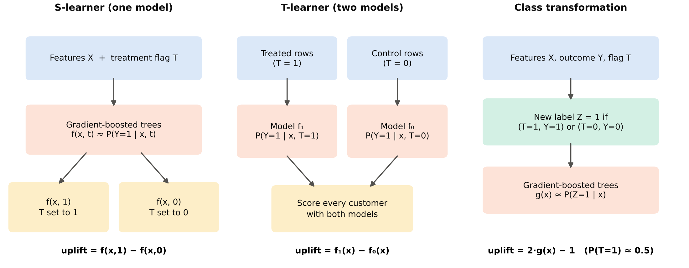
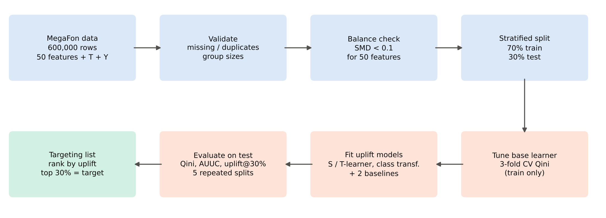

# Methodology

This page explains the method behind the code in more detail than the README. The full write-up is the
research paper in [`reports/paper.pdf`](../reports/paper.pdf).

## 1. Problem setting

Each customer has features $x$, a treatment flag $T$ (1 = received the offer, 0 = control) and a binary
outcome $Y$ (1 = converted). In the potential-outcomes framework (Rubin, 1974) every customer has two
outcomes, $Y(1)$ and $Y(0)$, but only one is ever observed. The quantity we want is the conditional
average treatment effect, called **uplift**:

$$\text{uplift}(x) = \mathbb{E}[Y(1) - Y(0) \mid X = x].$$

Because the MegaFon campaign was randomized, $T$ is independent of $X$, and uplift can be estimated from
observed data:

$$\text{uplift}(x) = P(Y=1 \mid X=x, T=1) - P(Y=1 \mid X=x, T=0).$$

Randomization is checked in the code with the standardized mean difference of every feature
(`data.standardized_mean_difference`). All 50 values are below 0.005, far under the usual 0.1 threshold.

## 2. Models

All tree-based models use scikit-learn's `HistGradientBoostingClassifier` as the base learner
(`models.hgb`), wrapped by scikit-uplift.

| Approach | scikit-uplift class | Training | Uplift score |
|---|---|---|---|
| S-learner | `SoloModel(method="dummy")` | one model on $[x, T]$ | $f(x,1) - f(x,0)$ |
| T-learner | `TwoModels(method="vanilla")` | $f_1$ on treated rows, $f_0$ on control rows | $f_1(x) - f_0(x)$ |
| Class transformation | `ClassTransformation` | one model on $Z = 1$ if $T = Y$ | $2P(Z=1 \mid x) - 1$ |
| Linear T-learner | `TwoModels` + logistic regression | as T-learner | $f_1(x) - f_0(x)$ |
| Conversion model (baseline) | scikit-learn only | one model on $x$, ignores $T$ | $P(Y=1 \mid x)$ |
| Random (baseline) | – | none | uniform noise |

Class transformation (Jaskowski & Jaroszewicz, 2012) is valid here because the treatment share is
50.06%, close to the 0.5 the formula assumes.

## 3. Tuning

Settings of the base learner are chosen by the **mean 3-fold cross-validated Qini coefficient on the
training set only** (`evaluation.tune`). The grid is in `config.GRID`:

| Learning rate | Max leaves | Trees |
|---|---|---|
| 0.10 | 31 | 200 |
| 0.05 | 31 | 300 |
| 0.10 | 15 | 200 |
| 0.10 | 63 | 150 |

Fixed: `min_samples_leaf=100`, `l2_regularization=1.0`, no early stopping, `random_state=42`.
Selected: 0.10 / 63 / 150 for the S- and T-learner, 0.05 / 31 / 300 for class transformation.

## 4. Metrics

Accuracy and ROC AUC are not used to select models: a model can predict conversion well and still rank
customers badly by treatment effect (Radcliffe, 2007).

- **Qini curve.** For the top $k$ customers by score,
  $Q(k) = Y^T(k) - Y^C(k)\,\dfrac{N^T(k)}{N^C(k)}$, the number of incremental conversions.
- **Qini coefficient.** Area between the Qini curve and the random line, divided by the same area for a
  perfect ranking. Random = 0, perfect = 1. This is also the official metric of the MegaFon competition.
- **AUUC.** The same normalization applied to the uplift curve.
- **Uplift@30%.** Treatment conversion rate minus control conversion rate among the 30% of customers with
  the highest scores, which matches the campaign budget.

## 5. Validation design

1. One stratified 70/30 split (strata = $T \times Y$, seed 42). The test set is used only at the end.
2. Tuning by cross-validation inside the training set.
3. Every model is re-trained and evaluated on five stratified splits (seeds 42, 7, 123, 2024, 99).
   The final model is the uplift approach with the highest mean Qini.
4. Feature influence is measured by permutation importance on the Qini coefficient (60,000 test
   customers, 2 repeats per feature).

## References

- Jaskowski, M., & Jaroszewicz, S. (2012). Uplift modeling for clinical trial data. *ICML Workshop on Clinical Data Analysis*.
- Künzel, S. R., Sekhon, J. S., Bickel, P. J., & Yu, B. (2019). Metalearners for estimating heterogeneous treatment effects using machine learning. *PNAS, 116*(10), 4156–4165.
- Radcliffe, N. J. (2007). Using control groups to target on predicted lift. *Direct Marketing Analytics Journal*, 14–21.
- Rubin, D. B. (1974). Estimating causal effects of treatments in randomized and nonrandomized studies. *Journal of Educational Psychology, 66*(5), 688–701.
